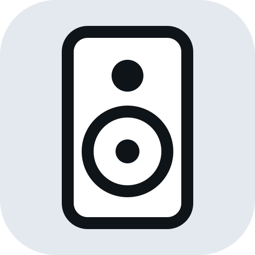

# ioBroker.arylic

Controls Arylic amplifiers over the network — the settings that neither AirPlay nor the web interface
offer: a maximum volume, tone, input, LEDs, standby.

Playback stays with AirPlay, DLNA or Music Assistant. This adapter does not play anything.

## Supported devices

| Device | Status |
| --- | --- |
| Arylic LA50 | tested |
| Up2Stream Mini/Pro/Amp V3 and other LinkPlay-based devices | not supported yet — see below |

The LA50 forwards plain text on TCP port 2018 to its amplifier chip, in the format of the
[Arylic UART API](https://developer.arylic.com/uartapi/). The LinkPlay-based Up2Stream boards accept
the same commands, but wrapped (`MCU+PAS+RAKOIT:…&`) in their TCP API. The adapter is built so that
this can be added as a second transport — if you own such a device and can test, please open an issue.

## Finding devices

With **Find devices automatically** on, the adapter listens for AirPlay announcements (mDNS) carrying
`manufacturer=Arylic`. The serial number is the device's object id, so a new IP address is picked up
without any change. ioBroker must be in the same network segment; in Docker, use host networking.

Devices in another subnet can be entered by IP address.

## States

Per device, below `arylic.0.<serial>`:

| State | Command | Writable | Notes |
| --- | --- | --- | --- |
| `volume` | `VOL` | yes | 0–100 |
| `maxVolume` | `MXV` | yes | 30–100, upper limit for every source; kept after a factory reset |
| `mute` | `MUT` | yes | |
| `source` | `SRC` | yes | one of `sources` |
| `bass`, `mid`, `treble` | `BAS`, `MID`, `TRE` | yes | −10…10 dB |
| `led` | `LED` | yes | |
| `beep` | `BEP` | yes | confirmation tone |
| `name` | `NAM` | yes | device name, also the AirPlay name |
| `playing` | `PLA` | no | |
| `sources` | `LST` | no | available inputs |
| `standby` | `SYS:STANDBY` | button | ⚠️ see below |
| `info.connected` | | no | TCP connection to the device |
| `info.ip` | `IPA` | no | |
| `info.mcuVersion` | `VER` | no | amplifier chip firmware |
| `info.model`, `info.serial`, `info.firmware` | | no | from the mDNS announcement |

A write is a command (`ack=false`). The device's answer sets the value again with `ack=true` — if it
stays `ack=false`, the device did not accept the command.

⚠️ **Standby:** Nothing over the network wakes an LA50 from standby — the web interface is gone as
well, and the UART API has no wake command. Only the IR remote brings it back.

## Changelog

<!--
    Placeholder for the next version (at the beginning of the line):
    ### **WORK IN PROGRESS**
-->
### **WORK IN PROGRESS**

- (Timo Schneider) published through GitHub Actions (npm trusted publishing)

### 0.0.1 (2026-10-13)

- (Timo Schneider) initial release

## License

MIT License

Copyright (c) 2026 Timo Schneider <timo@schnti.de>

Permission is hereby granted, free of charge, to any person obtaining a copy
of this software and associated documentation files (the "Software"), to deal
in the Software without restriction, including without limitation the rights
to use, copy, modify, merge, publish, distribute, sublicense, and/or sell
copies of the Software, and to permit persons to whom the Software is
furnished to do so, subject to the following conditions:

The above copyright notice and this permission notice shall be included in all
copies or substantial portions of the Software.

THE SOFTWARE IS PROVIDED "AS IS", WITHOUT WARRANTY OF ANY KIND, EXPRESS OR
IMPLIED, INCLUDING BUT NOT LIMITED TO THE WARRANTIES OF MERCHANTABILITY,
FITNESS FOR A PARTICULAR PURPOSE AND NONINFRINGEMENT. IN NO EVENT SHALL THE
AUTHORS OR COPYRIGHT HOLDERS BE LIABLE FOR ANY CLAIM, DAMAGES OR OTHER
LIABILITY, WHETHER IN AN ACTION OF CONTRACT, TORT OR OTHERWISE, ARISING FROM,
OUT OF OR IN CONNECTION WITH THE SOFTWARE OR THE USE OR OTHER DEALINGS IN THE
SOFTWARE.
